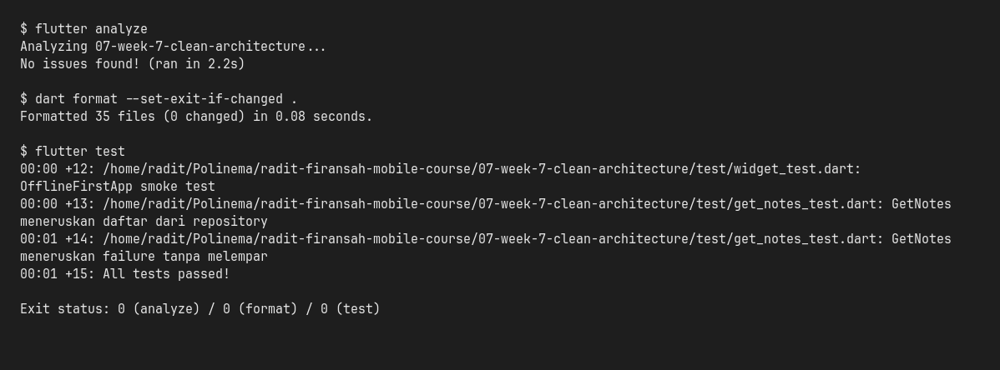
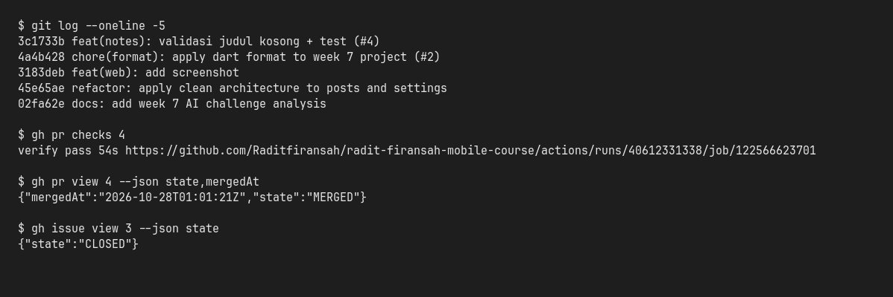

# Minggu 8 — Mid Project Review & Code Review

Deliverable Minggu 8 untuk repository portfolio
[`radit-firansah-mobile-course`](https://github.com/Raditfiransah/radit-firansah-mobile-course).
Project yang direview adalah **`07-week-7-clean-architecture`** (lanjutan Minggu
5–7), bukan project baru. Folder ini menyimpan **dokumentasi review**; kode
aplikasi tetap di folder Minggu 7 agar tidak ada duplikasi.

> **Status paruh semester: selesai.** Aplikasi berjalan identik dengan akhir
> Minggu 7, ditambah satu perbaikan kecil (validasi judul catatan, PR #4).
> Tiga pemeriksaan mesin hijau — `flutter analyze`, `dart format
> --set-exit-if-changed .`, dan `flutter test` (15 test) — dan CI menolak PR
> kotor lewat `.github/workflows/ci.yml`.

## Fitur utama

- **Catatan (Notes)** — CRUD SQLite lokal, flag `dirty` untuk antrean
  sinkronisasi, validasi judul kosong di layer domain.
- **Posts (Cache-First)** — baca cache SQLite lalu refresh dari REST API
  (JSONPlaceholder) di background.
- **Pengaturan** — dark mode, waktu terakhir dibuka, toggle *Force Offline*
  (`shared_preferences`).

## Stack teknologi

Flutter 3.47.5 / Dart 3.13.4, `flutter_riverpod` (state + DI), `go_router`
(navigasi), `sqflite` + `sqflite_common_ffi` (SQLite lokal), `dio` (REST API),
`shared_preferences`, GitHub Actions (CI).

## Cara menjalankan

```bash
cd 07-week-7-clean-architecture
flutter pub get
flutter run            # desktop/web via sqflite_common_ffi
```

Verifikasi mesin (semua harus exit 0):

```bash
flutter analyze
dart format --set-exit-if-changed .
flutter test
```

## Peta issue → Pull Request

| Issue | PR | Isi | Hasil |
| :--- | :--- | :--- | :--- |
| [#1](https://github.com/Raditfiransah/radit-firansah-mobile-course/issues/1) | [#2](https://github.com/Raditfiransah/radit-firansah-mobile-course/pull/2) | `chore(format)`: terapkan `dart format` (21 file) | Merged `4a4b428` |
| [#3](https://github.com/Raditfiransah/radit-firansah-mobile-course/issues/3) | [#4](https://github.com/Raditfiransah/radit-firansah-mobile-course/pull/4) | `feat(notes)`: validasi judul kosong + test + CI | Merged `3c1733b` |
| [#5](https://github.com/Raditfiransah/radit-firansah-mobile-course/issues/5) | [#6](https://github.com/Raditfiransah/radit-firansah-mobile-course/pull/6) | `docs`: deliverable mid-project review | Merged (PR ini) |

Branching yang dipakai: `main` (rilis, tidak disentuh) ← `develop` (default,
integrasi) ← `feature/*` / `chore/*`. Semua perubahan masuk lewat PR ke
`develop`, lalu squash-merge dan branch dihapus.

## Hasil mesin

| Pemeriksaan | Perintah | Hasil |
| :--- | :--- | :--- |
| Static analysis | `flutter analyze` | **No issues found** |
| Format | `dart format --set-exit-if-changed .` | **35 file, 0 berubah** (exit 0) |
| Test | `flutter test` | **15 test lulus** |
| CI | `.github/workflows/ci.yml` | **success** — [run 40612331338](https://github.com/Raditfiransah/radit-firansah-mobile-course/actions/runs/40612331338) |
| Ukuran PR | PR #4 | 6 file, +201/−42 (243 baris) — di bawah 300 |





## Struktur folder

```
08-week-8-mid-project-review/
├── README.md                        # dokumen ini
├── docs/
│   ├── review-checklist.md          # audit Git + checklist kesiapan
│   └── ai-review-vs-keputusan.md    # prompt AI, temuan, verifikasi, keputusan
└── screenshots/
    ├── 01-verify-analyze-format-test.png
    └── 02-git-flow-ci-merge.png
```

## Limitasi yang dicatat jujur

- **Peer review disimulasikan.** Repo dikerjakan solo, jadi review di PR
  dilakukan oleh AI reviewer + verifikasi manual penulis, bukan pasangan
  manusia. Setiap temuan diverifikasi dengan `grep`, test, atau reproduksi
  manual sebelum diterima/ditolak — lihat
  [`docs/ai-review-vs-keputusan.md`](docs/ai-review-vs-keputusan.md).
- **Screenshot hanya bukti terminal.** Environment tidak punya Chrome/emulator;
  screenshot UI aplikasi belum diambil (sama seperti catatan Minggu 7). PNG
  dibuat dari output terminal asli, bukan mockup.

## Dokumen terkait

- [`docs/review-checklist.md`](docs/review-checklist.md) — audit riwayat Git,
  tabel perbaikan pesan commit, checklist kesiapan tengah semester.
- [`docs/ai-review-vs-keputusan.md`](docs/ai-review-vs-keputusan.md) — prompt
  AI, output awal, tabel usulan vs keputusan, bukti penerimaan/penolakan.
- [`../07-week-7-clean-architecture/README.md`](../07-week-7-clean-architecture/README.md)
  — detail arsitektur dan hasil praktikum Minggu 7.