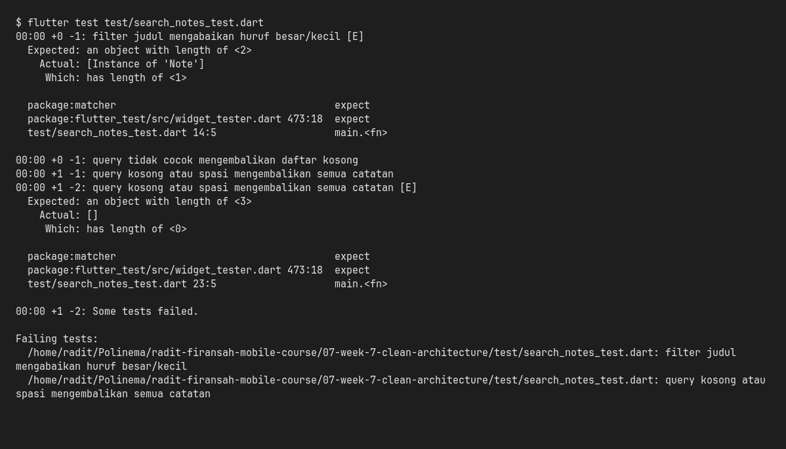
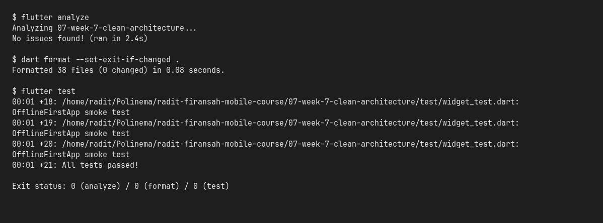
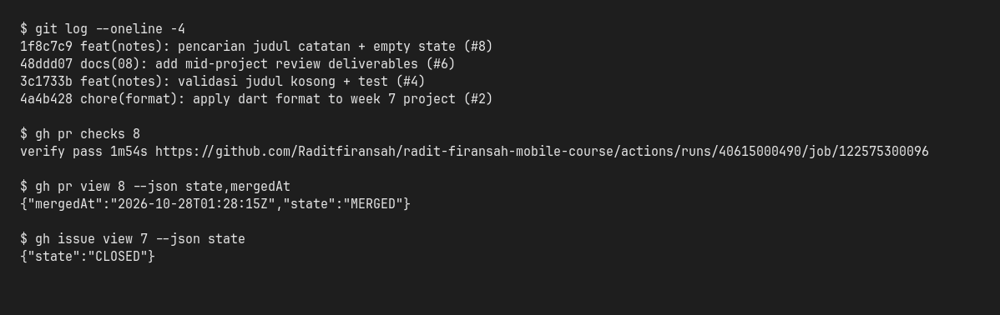

# Minggu 9 — AI-Assisted Development / Vibe Coding

Deliverable Minggu 9 untuk
[`radit-firansah-mobile-course`](https://github.com/Raditfiransah/radit-firansah-mobile-course).
Fitur ditambahkan ke project yang sudah lolos review Minggu 7–8
(`07-week-7-clean-architecture`), bukan project baru. Folder ini menyimpan
**dokumentasi proses AI**; kode tetap di folder Minggu 7.

> **Status: selesai.** Fitur pencarian judul catatan + empty state sudah merged
> lewat PR #8. `flutter analyze` bersih, `dart format --set-exit-if-changed .`
> exit 0, `flutter test` **21 test lulus**, dan CI hijau.

## Fitur yang ditambahkan

- **Pencarian judul catatan** — case-insensitive, query kosong/spasi
  menampilkan semua catatan.
- **Empty state dibedakan** — *Belum ada catatan* vs
  *Tidak ada catatan yang cocok dengan "…"*.
- **Aturan filter di domain** — `SearchNotes` murni (tanpa Flutter/Dio/SQLite),
  diuji tanpa widget; UI hanya mengurus state query dan tampilan.

## Prompt inti (5 slot)

| Slot | Isi |
| :--- | :--- |
| **Peran** | Senior Flutter developer |
| **Konteks** | `week5_offline_notes`, feature-first Clean Architecture (`presentation → domain ← data`), Riverpod, GoRouter, SQLite + Dio |
| **Tugas** | Tambah pencarian judul notes + empty state |
| **Batas** | Jangan ubah arsitektur; maks 80 baris; jangan panggil SQLite dari widget; tanpa dependency baru |
| **Output** | Kode + 3 test case + cara uji |

Prompt lengkap, konteks yang ditempel, output awal AI, bukti test merah, dan
tabel keputusan ada di [`docs/ai-log.md`](docs/ai-log.md).

## Halusinasi AI yang ditemukan

Draft pertama memakai `note.title.contains(query)` — **case-sensitive** dan
tidak men-trim query. Dibuktikan dengan test merah:

```text
Expected: an object with length of <2>
  Actual: [Instance of 'Note']  (length 1)
```

Perbaikan: `query.trim().toLowerCase()` + `title.toLowerCase().contains(...)`.
Akar masalah dan bukti lengkap: [`docs/ai-log.md`](docs/ai-log.md) §3.

## Stack teknologi

Flutter 3.47.5 / Dart 3.13.4, `flutter_riverpod`, `go_router`, `sqflite`,
`dio`, `shared_preferences`, GitHub Actions (CI).

## Cara menjalankan

```bash
cd 07-week-7-clean-architecture
flutter pub get
flutter run
```

Verifikasi:

```bash
flutter analyze
dart format --set-exit-if-changed .
flutter test
```

Uji manual pencarian: buka tab **Catatan**, lalu (1) biarkan kosong → semua
catatan; (2) ketik `BELANJA` → cocok tanpa peduli huruf besar/kecil; (3) ketik
`zzz` → empty state.

## Hasil mesin

| Pemeriksaan | Hasil |
| :--- | :--- |
| `flutter analyze` | **No issues found** |
| `dart format --set-exit-if-changed .` | **38 file, 0 berubah** (exit 0) |
| `flutter test` | **21 test lulus** (18 unit/use case + 3 widget pencarian) |
| CI `verify` | **success** — [run 40615000490](https://github.com/Raditfiransah/radit-firansah-mobile-course/actions/runs/40615000490) |







## Peta issue → PR

| Issue | PR | Isi | Hasil |
| :--- | :--- | :--- | :--- |
| [#7](https://github.com/Raditfiransah/radit-firansah-mobile-course/issues/7) | [#8](https://github.com/Raditfiransah/radit-firansah-mobile-course/pull/8) | `feat(notes)`: pencarian judul + empty state + test | Merged `1f8c7c9` |
| [#9](https://github.com/Raditfiransah/radit-firansah-mobile-course/issues/9) | [#10](https://github.com/Raditfiransah/radit-firansah-mobile-course/pull/10) | `docs(09)`: deliverable AI-assisted development | Merged (PR ini) |

## Struktur folder

```
09-week-9-ai-assisted-development/
├── README.md
├── docs/
│   └── ai-log.md                    # prompt, output AI, verifikasi, keputusan
└── screenshots/
    ├── 01-red-test-case-sensitive.png
    ├── 02-verify-analyze-format-test.png
    └── 03-ci-pr-merge.png
```

## Limitasi yang dicatat jujur

- **AI reviewer = asisten yang sama dengan penulis.** Draft awal dibuat
  terkontrol, lalu dibuktikan salah lewat test merah — bukan AI independen.
  Setiap temuan diverifikasi dengan `grep`/test sebelum diterima atau ditolak.
- **Screenshot hanya terminal.** Tidak ada Chrome/emulator di environment; uji
  manual 3 query didokumentasikan dan ditutup widget test, bukan screenshot UI.

## Dokumen terkait

- [`docs/ai-log.md`](docs/ai-log.md) — prompt 5 slot, output awal AI, 6 langkah
  verifikasi, bukti test merah, tabel review AI (2 diterima, 1 ditolak).
- [`../07-week-7-clean-architecture/README.md`](../07-week-7-clean-architecture/README.md)
  — arsitektur dan hasil praktikum Minggu 7.
- [`../08-week-8-mid-project-review/README.md`](../08-week-8-mid-project-review/README.md)
  — review tengah semester dan AI review Minggu 8.