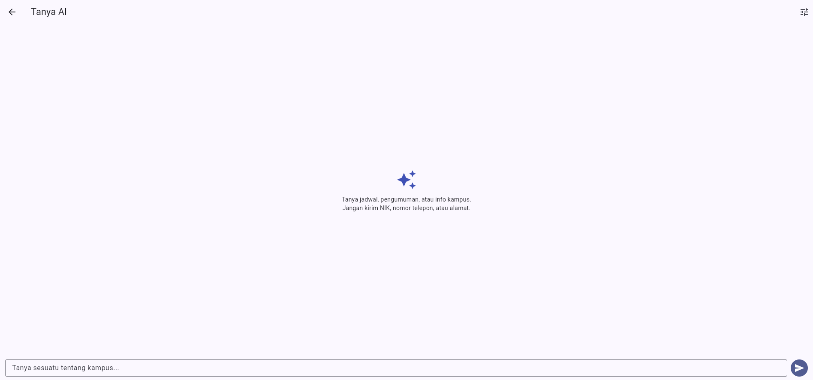
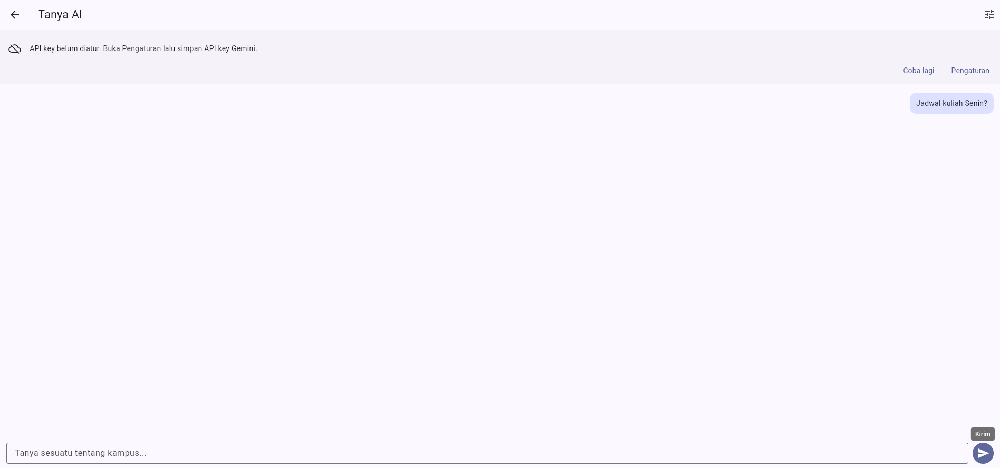
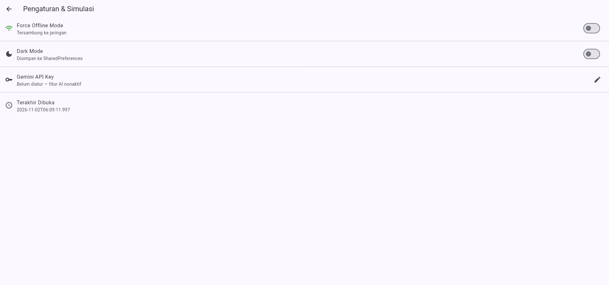

# Minggu 10 — Integrasi Fitur AI

Deliverable Minggu 10 untuk
[`radit-firansah-mobile-course`](https://github.com/Raditfiransah/radit-firansah-mobile-course).
Fitur AI ditambahkan ke project yang sudah ada dari
[`05-week-5-local-storage-offline-first`](../05-week-5-local-storage-offline-first/week5_offline_notes)
(offline-first notes: Riverpod, GoRouter, SQLite + `cached_posts`, Dio), bukan
project baru. Folder ini berisi project utuh (`lib/`, `test/`) plus dokumentasi.

> **Status: selesai.** `flutter analyze` **No issues found**, `flutter test`
> **13 test lulus**, `flutter build web --release` sukses, dan alur UI
> (chat, fallback, pengaturan key) sudah diuji manual di Chrome.

## Fitur AI yang diintegrasikan

**Chat asisten kampus dengan streaming response (Google Gemini).** Satu fitur
saja, dipilih karena paling menyentuh semua poin codelab: prompt design,
streaming, privasi, biaya, dan fallback.

- `lib/ai/ai_service.dart` — panggilan `streamGenerateContent` (`alt=sse`),
  parsing SSE per baris, pesan error yang dipetakan per status code.
- `lib/ai/api_key_store.dart` — API key hanya di `flutter_secure_storage`,
  tidak pernah masuk kode sumber atau repo.
- `lib/ai/rate_limiter.dart` — kuota **20 permintaan/hari** per perangkat.
- `lib/providers/ai_providers.dart` — `ChatController` merangkai chunk jadi
  jawaban yang tampil bertahap, plus `retry()`.
- `lib/pages/chat_page.dart` — chat bubble, indikator streaming, banner error.
- `lib/pages/settings_page.dart` — simpan/hapus API key + status key.
- Entry point: ikon ✨ di AppBar beranda → `/chat`.

## Prompt design

| Komponen | Isi |
| :--- | :--- |
| **System prompt** | "Kamu asisten kampus yang ramah. Jawab dalam Bahasa Indonesia, maksimal 2 kalimat, dan langsung ke inti. Jangan pernah meminta, mengulang, atau menyimpan NIK, nomor telepon, alamat, atau data pribadi pengguna." |
| **User prompt** | Pertanyaan bebas dari kolom chat, di-trim sebelum dikirim. |
| **Konteks** | Riwayat percakapan sesi ini (`history`) dikirim ulang agar jawaban nyambung; tidak ada data catatan pengguna yang dikirim. |
| **Batas** | `maxOutputTokens: 512`, `temperature: 0.4`, tanpa data sensitif. |
| **Output** | Hanya teks jawaban; tidak ada aksi otomatis dari jawaban AI. |

Prompt lengkap, output awal AI, dan tabel keputusan ada di
[`docs/ai-log.md`](docs/ai-log.md).

## Tabel risiko dan mitigasi

| Risiko | Mitigasi di kode |
| :--- | :--- |
| **Bocor data pengguna** | System prompt melarang meminta/mengulang data pribadi; isi catatan tidak pernah ikut terkirim; key disimpan di `flutter_secure_storage`, bukan `pubspec`/source. |
| **Biaya melonjak** | `RateLimiter` membatasi 20 request/hari per perangkat; `maxOutputTokens: 512`; tidak ada retry otomatis tanpa aksi user. |
| **API error / down** | Status 400/403/429/5xx dipetakan ke pesan ramah; `SocketException`/`ClientException`/`TimeoutException` (30 detik) ditangani; banner menyediakan **Coba lagi** dan **Pengaturan**. |
| **Respons tidak relevan / kosong** | Respons kosong dianggap gagal (`AiException`), bukan bubble kosong; `temperature` rendah agar jawaban stabil. |
| **Key belum diatur** | `hasApiKey()` dicek sebelum request → pesan "API key belum diatur" + tombol ke Pengaturan; status key tampil di halaman Pengaturan. |
| **Mode offline** | `forceOfflineProvider` (sudah ada dari Minggu 5) dicek lebih dulu: request AI ditolak dan user diarahkan ke catatan lokal, bukan menunggu timeout. |

## Cara menjalankan

```bash
cd 10-week-10-ai-feature-integration
flutter pub get
flutter run          # atau: flutter run -d chrome
```

1. Buka **Pengaturan** (ikon ⚙ / ikon tune di halaman chat) → **Gemini API Key**
   → tempel key dari [Google AI Studio](https://aistudio.google.com/apikey).
2. Kembali ke beranda → ikon ✨ → tanya sesuatu.
3. Matikan key (tombol **Hapus**) atau aktifkan **Force Offline** untuk melihat
   jalur fallback.

Verifikasi:

```bash
flutter analyze
dart format --set-exit-if-changed .
flutter test
```

## Hasil mesin

| Pemeriksaan | Hasil |
| :--- | :--- |
| `flutter analyze` | **No issues found!** |
| `dart format --set-exit-if-changed .` | **exit 0** (tidak ada file berubah) |
| `flutter test` | **13 test lulus** (5 unit AI service + rate limiter, 3 widget chat, 4 note, 1 smoke) |
| `flutter build web --release` | **✓ Built build/web** |

Bukti UI:







## Struktur folder

```
10-week-10-ai-feature-integration/
├── README.md
├── docs/
│   └── ai-log.md              # prompt, output awal AI, verifikasi, keputusan
├── lib/
│   ├── ai/
│   │   ├── ai_service.dart    # Gemini streaming + parsing SSE + error mapping
│   │   ├── api_key_store.dart # flutter_secure_storage
│   │   └── rate_limiter.dart  # kuota harian
│   ├── pages/chat_page.dart   # UI chat + streaming indicator + banner error
│   └── ...                    # sisa project Minggu 5 (notes, posts, sync)
├── screenshots/
└── test/
    ├── ai_service_test.dart   # SSE, system prompt, error 429, rate limit
    └── chat_page_test.dart    # kirim pesan, banner error, mode offline
```

## Limitasi yang dicatat jujur

- **Screenshot jawaban AI asli tidak ada.** Repo tidak menyimpan API key, dan
  environment ini tidak punya key Gemini valid — tangkapan layar yang tersedia
  adalah jalur fallback (key belum diatur & key ditolak). Jalur streaming sukses
  ditutup `ai_service_test.dart` (MockClient) dan `chat_page_test.dart` (fake
  service), bukan screenshot.
- **Rate limit berbasis perangkat**, bukan per akun — `shared_preferences` bisa
  dihapus user. Untuk produksi, batas harus ditegakkan di backend.
- **`gemini-2.5-flash`**, bukan `gemini-pro` seperti contoh codelab; nama model
  lama sudah tidak tersedia di endpoint `v1beta`.
- **Key di klien tetap bisa diekstrak** dari aplikasi yang di-reverse
  engineering. Pola aman untuk produksi: proxy backend, key hanya di server.
- **Web build**: `flutter_secure_storage` di web memakai WebCrypto + localStorage,
  sehingga keamanannya lebih lemah daripada Keystore/Keychain di mobile.

## Dokumen terkait

- [`docs/ai-log.md`](docs/ai-log.md) — prompt 5 slot, output awal AI, 6 langkah
  verifikasi, dan tabel terima/tolak.
- [`../05-week-5-local-storage-offline-first`](../05-week-5-local-storage-offline-first)
  — project basis (offline-first, cache-first, sync dirty notes).
